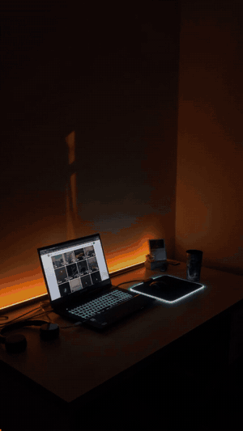
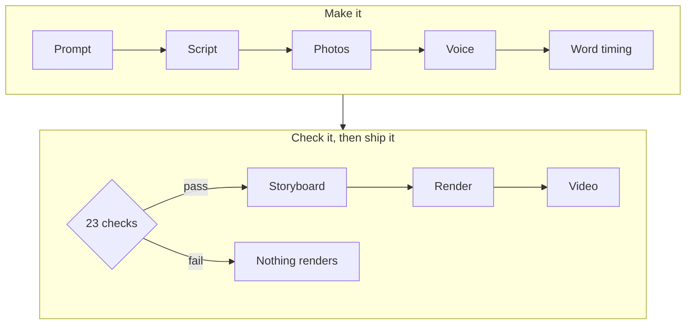

# prompt-to-video

**One prompt in. One finished, narrated video out.**

<p align="center">
  <a href="media/prompt-to-video.mp4"></a>
</p>

<p align="center"><b><a href="media/prompt-to-video.mp4">▶ Watch the full 72-second video, with sound</a></b></p>

This video was made by the engine it describes. I typed a prompt, and everything
in it came out of a pipeline I built with Claude Code: the script, the photos,
the narration in my cloned voice, captions timed to every word, the sound
effects, the music and the render.

> *"Make a short video about my workflow: prompt, script, images, APIs, sites, effects, renderer, video. Keep it simple."*
>
> the prompt, as it appears in the video

The prompt is the easy part. This repo is about the workflow behind it.

> [!NOTE]
> This is a case study, not the source. The engine is private.
> You're welcome to [try running it](#run-it-yourself) anyway.

---

## How it works



| Step | In plain words |
|---|---|
| **Script** | Claude turns the prompt into scenes: what is said, and what is on screen while it's said. |
| **Photos** | Claude picks a few search words for each scene, and a free photo site sends a match. |
| **Voice** | The script is read in my own cloned voice. In the other mode, a phone recording of me is cropped and cleaned up, with the retakes cut out automatically. |
| **Word timing** | A speech-to-text model listens to the narration and times every word. The script supplies the spelling; the model only supplies the timing. |
| **Checks** | 23 automated checks. If one fails, nothing renders. |
| **Storyboard** | One still per scene and one per on-screen moment, on a single sheet, looked at before anything is rendered. |
| **Render** | The scenes are drawn as video, one frame at a time, 30 frames a second. |

## By the numbers

| | |
|---|---|
| This video | 72 s · 12 scenes · 1080×1920 · 2,159 frames |
| Input | 1 prompt |
| Rules the engine follows | 35, each written after something shipped broken |
| Automated checks | 23, each broken on purpose once to prove it fires |
| The engine | ~4,900 lines across 43 files (private) |
| Caption languages | English, Telugu, Hindi |
| Built with | Claude Code · Node.js · Remotion · ffmpeg · ElevenLabs · Whisper · Pexels |

## What's in here

| | |
|---|---|
| [`media/`](media) | The video and the teaser |
| [`example/script.md`](example/script.md) | The script Claude wrote from the prompt |
| [`example/storyboard.jpg`](example/storyboard.jpg) | The sheet that gets checked before every render |
| [`evidence/`](evidence) | Real output from the engine's checks |
| [`LESSONS.md`](LESSONS.md) | Twelve of the 35 rules, and the failure behind each one |

## Run it yourself

Needs Node 20 or newer.

```bash
npm install
node make.mjs "a short video about my morning coffee"
```

## Where's the code?

On my machine, making the next video. It took a lot of broken renders to get
right, and I use it for my own work.

If you're building something like it and want to compare notes, find me at
[chethandandgey.com](https://chethandandgey.com).

---

<sub>The video and the writing here are mine, and no license is granted. Photos in the video are from Pexels. The music and sound effects were synthesised by the engine.</sub>
